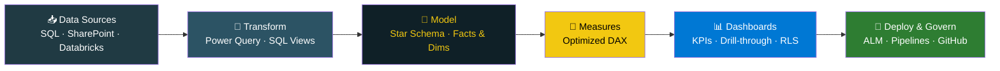

# Babinton-s-Portfolio

<!-- ============ ANIMATED HEADER BANNER ============ -->

  

<!-- ============ ANIMATED TYPING TAGLINE (GIF-STYLE) ============ -->

  

  
  
  

  
  
  

---

## 👋 About Me

I'm a **Data Engineer & Power BI Developer** with **7+ years** of experience building data models, dashboards, and automation solutions that replace manual reporting with reliable, governed, decision-ready insights.

My work sits at the intersection of **analytics, automation, and compliance**:

- 📊 Designing **star-schema data models** and **optimized DAX** for enterprise Power BI reporting
- ⚙️ Automating business processes with **Power Apps + Power Automate + SharePoint**
- 🔍 Leading **root cause analysis** on data discrepancies using **SQL & Azure Databricks**
- 🔐 Delivering **Row-Level Security (RLS)** and governance-ready reporting across multiple legal entities
- 🚀 Deploying managed solutions through **Power Platform ALM** (environments, pipelines, connection references)

> 💡 *"If a process is done manually twice, it's a candidate for automation."*

---

## 🎯 Impact at a Glance

<table align="center">
  <tr>
    <td align="center"><h2>7+</h2>Years of Experience</td>
    <td align="center"><h2>95%</h2>Discrepancies Resolved via RCA</td>
    <td align="center"><h2>98%</h2>Improved Data Reporting Integrity</td>
    <td align="center"><h2>40%</h2>Manual Effort Reduced</td>
    <td align="center"><h2>20%</h2>Defect Reduction</td>
  </tr>
</table>

---

## 🧰 Tech Stack

### 📈 Business Intelligence

  
  
  
  
  

### 🗄️ Data & Analytics

  
  
  
  
  
  

### ⚡ Microsoft Power Platform

  
  
  
  
  

### 🛠️ Tools & Practices

  
  
  
  
  

---

## 💼 Professional Experience

### 🔹 Senior Specialist – Data Engineering | LTIMindtree *(04/2026 – Present)*
> Compliance data automation & executive reporting for a global financial-services client (DORA program)

- ⚙️ Automated compliance data processes with **Power Apps Canvas apps, Power Automate, SharePoint & Power Fx**, consolidating legal-entity data into a centralized entry list → **25% less manual data entry**
- 📊 Built interactive **Power BI ROI dashboards** (DAX + DAX Studio) across legal entities, countries & business dimensions → **saved 0.5 FTE** of reporting effort
- 🔍 Led **RCA with SQL on Azure Databricks** → resolved **95%** of discrepancies; improved reporting integrity by **98%**
- 🔐 Delivered executive reporting with **Row-Level Security** → **10% faster decision-making**
- 🤝 Led cross-functional initiatives that **exceeded targets by 24%** and improved team efficiency by **33%**

### 🔹 Catalog Lead | Data Analyst – Amazon Development Centre *(08/2019 – 03/2026)*
> Analytics, automation & process excellence at scale

- 🤖 Automated reporting & validation (Excel flows + SQL) → **40% less manual effort**
- 📈 Built KPI **Power BI dashboards** → **0.5 HC** reporting effort saved
- 🔎 Led **RCA** with SQL → resolved **95%** of operational discrepancies; **+30% catalog accuracy**
- 🏅 Drove **Lean Six Sigma** initiatives → **20% defect reduction**, while mentoring teammates
- 📣 Data-driven insights improved **decision speed by 15%**; exceeded targets by **20%**

---

## 🚀 Featured Projects

| Project | What I Built | Tech | Impact |
|---|---|---|---|
| 🛡️ **DORA Compliance Program** | Canvas app for legal-entity data capture, CRUD flows, star-schema model, ROI & risk dashboards, managed-solution deployment (Dev → Prod) | `Power Apps` `Power Automate` `Power BI` `Databricks` `SharePoint` | 25% less manual entry · 95% RCA resolution |
| 📅 **WBR & MBR Reporting Automation** | Leadership dashboards with live SQL, drill-downs, automated data collection/cleaning/validation | `Power BI` `DAX` `SQL` `Power Automate` | +15% operational efficiency |
| 💸 **Price Drop Monitoring Analysis** | RCA + "4 Why" analysis to eliminate pricing false positives across 2B+ SKUs | `Power BI` `MySQL` | 50% reduction in price drops |

> 📁 **Add repo links here** → e.g. `[View Repo](https://github.com/Babinton1223/your-repo)` with sanitized/sample data and screenshots.

---

## 🏗️ How I Build Solutions

---

## 📊 GitHub Stats

  
  

  

---

## 🎓 Education & Certifications

- 🎓 **B.E. Mechanical Engineering** — SRM Easwari Engineering College, Chennai *(2015 – 2019)*
- 🥋 **Lean Six Sigma Green Belt** — KNET
- 🐍 **Python for Data Analysis** — Udemy
- 📊 **Microsoft Power BI** — LinkedIn Learning

## 🏆 Achievements

- 🌟 **Rising Star Award** — best performer & innovative ideation
- 🚀 **Above and Beyond Award** — two quarters, for outstanding quality and target achievement

---

## 🌱 Currently

- 🔭 Deepening skills in **Azure Databricks** and **data engineering pipelines**
- 📐 Exploring **DORA / engineering-metrics dashboards** with Azure DevOps data
- 🤝 Open to **Data Engineer · Senior Power BI Developer · BI/Analytics Engineer** roles

---

## 📫 Let's Connect

  
  

  

⭐ Thanks for visiting — data is only as good as the story it tells.

